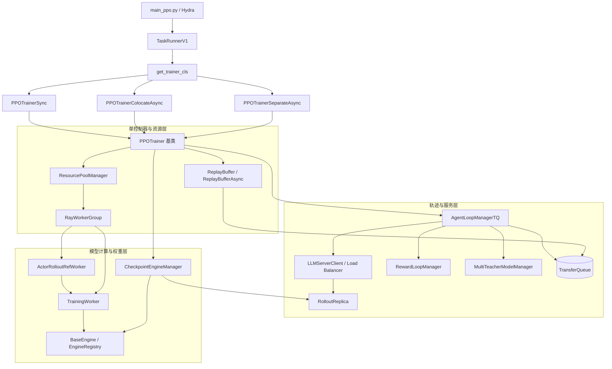
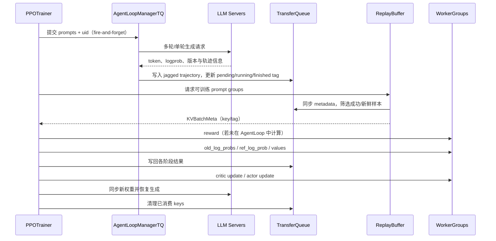

# verl 仓库架构与设计分析

本文按 `main` 分支当前代码梳理 `verl` 的控制面、数据面、训练/推理后端及同步与异步训练路径。重点是解释“代码现在如何运行”，而不是罗列项目功能。

> 基线：`main` / `origin/main`，commit `8718ca30a3f002f93b7c4fd99b9b2506718681bc`（2026-10-01），包版本 `0.10.0.dev`。本文核对日期为 2026-10-03。

## 1. 项目定位

`verl` 是面向大语言模型后训练的分布式强化学习框架，也是 HybridFlow 论文的开源实现。它解决的不是某一个 PPO 公式，而是把一条 RL 数据流中的多种角色和基础设施组织起来：

- 算法与控制流：rollout、reward、old/ref log probability、value、advantage、actor/critic update。
- 分布式资源：actor、rollout、critic、reference、reward model、teacher model 的放置与复用。
- 训练后端：FSDP/FSDP2、Megatron、VeOmni、TorchTitan、Automodel 等。
- 推理后端：vLLM、SGLang、TensorRT-LLM 的 server-mode rollout。
- 数据与权重传输：`DataProto`/`TensorDict`、TransferQueue、Checkpoint Engine。
- Agentic RL：多轮对话、工具调用、多模态轨迹、异步 reward 与 teacher 服务。

一句话概括：**verl 用单控制器表达 RL 控制流，用成熟后端执行分布式计算，再用统一的数据、worker 和权重同步协议把它们连接起来。**

## 2. 当前主线：从 V0 Driver 到 V1 数据流

理解当前代码时，最重要的事实是：默认主线已经不是旧的 `RayPPOTrainer`。

- [`verl/trainer/main_ppo.py`](../verl/trainer/main_ppo.py) 中 `trainer.use_v1` 默认是 `true`。
- 默认启动 `TaskRunnerV1`，再按 `trainer.v1.trainer_mode` 选择 V1 Trainer。
- V1 有 `sync`、`colocate_async`、`separate_async` 三种模式。
- `TaskRunnerV1` 会启用并初始化 TransferQueue；rollout worker 将轨迹写入队列，Trainer 通过 replay buffer 取样。
- 旧入口逻辑已移到 [`verl/trainer/main_ppo_v0.py`](../verl/trainer/main_ppo_v0.py)，其中创建的 [`RayPPOTrainer`](../verl/trainer/ppo/ray_trainer.py) 是兼容路径。

因此，当前架构应当理解为两条并存但地位不同的路径：

| 路径 | 控制器 | 主要数据交换 | 状态 |
| --- | --- | --- | --- |
| V1 | `PPOTrainer` 及三个模式子类 | TransferQueue + `TensorDict`/`KVBatchMeta` | 默认主线 |
| V0 | `RayPPOTrainer` | `DataProto` 经 Driver/WorkerGroup 流转 | 兼容、已标记 deprecated |

V1 没有推翻 HybridFlow，而是进一步落实了“控制流与大 payload 数据流分离”：控制器主要传递 key、tag 和批次元数据，轨迹张量由 TransferQueue 保存和传输。

## 3. 总体架构



可以把它分成五层：

1. **入口与配置层**：Hydra 组装运行时组件。
2. **单控制器层**：Trainer 决定每个阶段何时执行。
3. **资源与 RPC 层**：Ray resource pool、placement group、worker group 承载远端进程。
4. **轨迹数据层**：AgentLoop 生成轨迹，TransferQueue 保存 payload，replay buffer 选择可训练样本。
5. **模型执行层**：engine、rollout server 和 checkpoint engine 执行训练、推理与权重同步。

## 4. 目录与职责

| 路径 | 当前职责 |
| --- | --- |
| [`verl/trainer`](../verl/trainer) | RL/SFT/eval 入口、V0/V1 Trainer、算法与配置 |
| [`verl/trainer/ppo/v1`](../verl/trainer/ppo/v1) | 默认 V1 Trainer、TransferQueue adapter、replay buffer、三种调度模式 |
| [`verl/workers`](../verl/workers) | 统一 engine worker、rollout adapter、worker 配置和 V0 reward manager |
| [`verl/workers/engine`](../verl/workers/engine) | `BaseEngine`、registry 及各训练后端实现 |
| [`verl/workers/rollout`](../verl/workers/rollout) | rollout server adapter、replica、router、client/manager |
| [`verl/single_controller`](../verl/single_controller) | Worker、WorkerGroup、dispatch/collect、Ray 资源池 |
| [`verl/checkpoint_engine`](../verl/checkpoint_engine) | actor 到 rollout 的权重传输协议与后端 |
| [`verl/experimental/agent_loop`](../verl/experimental/agent_loop) | 单轮/工具调用 AgentLoop、轨迹后处理；已被 V1 主线复用 |
| [`verl/experimental/reward_loop`](../verl/experimental/reward_loop) | 异步 reward worker、manager、router；已被 V1 主线复用 |
| [`verl/experimental/teacher_loop`](../verl/experimental/teacher_loop) | 在线蒸馏的 teacher server 与请求管理 |
| [`verl/experimental/separation`](../verl/experimental/separation) | 分离式训练所需 worker；V1 `separate_async` 会直接使用 |
| [`verl/experimental/fully_async_policy`](../verl/experimental/fully_async_policy) | 独立的 fully-async 实验实现 |
| [`verl/experimental/one_step_off_policy`](../verl/experimental/one_step_off_policy) | 一步 off-policy 实验实现 |
| [`verl/protocol.py`](../verl/protocol.py) | `DataProto`、`DataProtoFuture`、批数据兼容协议 |
| [`verl/models`](../verl/models) | Transformers/Megatron-Core 模型适配与权重加载 |
| [`verl/model_merger`](../verl/model_merger) | 分布式 checkpoint/model 合并工具 |
| [`verl/plugin`](../verl/plugin) | 平台能力与硬件资源名等插件接口 |
| [`verl/tools`](../verl/tools) | Agent 工具、MCP、搜索与 sandbox 接入 |
| [`verl/utils`](../verl/utils) | dataset、checkpoint、profiling、logging、kernel、设备与分布式工具 |
| [`examples`](../examples) | PPO/GRPO/RLOO/REINFORCE++/GSPO 等示例 |
| [`recipe`](../recipe) | 指向独立 `verl-recipe` 仓库的 git submodule |

两个容易误判的边界：

1. `experimental` 不等于“完全未进入主流程”。V1 当前直接依赖其中的 agent loop、reward loop、teacher loop 和 separation 组件。
2. VLA 已不在当前 `verl/experimental` 包中；相关能力已发展为独立的 `verl-vla` 项目，不能再把 `verl/experimental/vla` 写成主仓现有模块。

## 5. 默认入口与初始化过程

[`main_ppo.py`](../verl/trainer/main_ppo.py) 的主过程如下：

1. Hydra 从 [`ppo_trainer.yaml`](../verl/trainer/config/ppo_trainer.yaml) 及 defaults 链加载配置。
2. `auto_set_device` 根据平台设置设备，`validate_config` 校验 critic/reference 等组合。
3. `run_ppo` 创建或连接 Ray runtime，并把必要环境变量传给 Ray actors。
4. 默认远程创建 `TaskRunnerV1`。
5. `TaskRunnerV1` 设置 `transfer_queue.enable = True`，初始化 TransferQueue。
6. `get_trainer_cls(trainer.v1.trainer_mode)` 返回对应 Trainer 类。
7. Trainer `init()` 创建资源池、worker group、rollout server、reward/teacher manager 和 checkpoint manager。
8. `AgentLoopManagerTQ` 建立后，Trainer 进入 `fit()`。
9. 无论成功或异常，Runner 最后负责结束 tracking 并关闭 TransferQueue。

入口脚本只决定装配与生命周期，不直接实现 FSDP、Megatron 或 vLLM 的内部算法。这是控制面和执行面的第一层解耦。

## 6. V1 的三种 Trainer 模式

三个模式共享 [`PPOTrainer`](../verl/trainer/ppo/v1/trainer_base.py) 中的大部分训练阶段，只覆盖资源切换、预取、partial rollout 和权重同步时机。

| 模式 | Rollout 资源 | Partial rollout | 主要语义 |
| --- | --- | --- | --- |
| `sync` | 与 trainer 同池的 hybrid replicas | 关闭 | 每步生成足够样本，暂停 rollout，再训练和同步 |
| `colocate_async` | 与 trainer 同池的 hybrid replicas | 开启 | 预热请求；阶段切换时中止并保留未完成轨迹，更新后继续 |
| `separate_async` | 独立 rollout 池，可同时保留 hybrid replicas | 开启 | rollout 持续进行，trainer 按 mini-batch 消费并定期同步权重 |

### 6.1 `sync`

[`PPOTrainerSync`](../verl/trainer/ppo/v1/trainer_sync.py) 是默认模式。它仍采用 hybrid engine：actor 训练与 rollout engine 共享 GPU 资源，按阶段释放/恢复权重和 KV cache。这里的“同步”指每个训练步的样本、更新和权重版本有明确边界；数据依然通过 TransferQueue 传递。

### 6.2 `colocate_async`

[`PPOTrainerColocateAsync`](../verl/trainer/ppo/v1/trainer_colocate_async.py) 继续共享 GPU，但用 `FullyAsyncLLMServerClient` 和 warmup batch 提前发起生成。进入训练前会 abort 未完成请求并让 replicas sleep；参数更新后恢复生成。已完成的 token 可保留，剩余生成在恢复后继续。

### 6.3 `separate_async`

[`PPOTrainerSeparateAsync`](../verl/trainer/ppo/v1/trainer_separate_async.py) 增加独立 rollout resource pool，并使用非 `naive` checkpoint engine 同步权重。它还有几项特殊机制：

- `parameter_sync_step`：一个 global step 内执行多少次局部 mini-batch 更新。
- `ReplayBufferAsync`：按模型版本控制样本陈旧度，可 `drop` 或 `wait`。
- Decoupled PPO：必要时保存/恢复 CPU 上的旧策略，使一个同步周期内的 `pi_old` 保持一致。
- hybrid GPU switching：可在 trainer 等样本时把空闲 hybrid replicas 借给 rollout。
- `actor_rollout_ref.hybrid_engine=False`：完全关闭 trainer GPU 上的 rollout replicas，只使用独立 rollout 池。

它不是简单地“多开一组 vLLM”，而是同时改变资源布局、采样粒度、off-policy 控制和权重同步路径。

## 7. V1 一步训练的数据流



[`PPOTrainer._step_once`](../verl/trainer/ppo/v1/trainer_base.py) 中的实际阶段顺序是：

1. replay buffer 从 TransferQueue 选择一批可训练轨迹。
2. 若 reward 没有在独立 reward workers 中完成，则计算 colocated reward。
3. 按 data-parallel workload 做 batch balance。
4. 计算或取得 `old_log_probs`。
5. 按需计算 reference log probability。
6. 按需计算 critic values。
7. 计算 advantage 和 return。
8. 按需更新 critic。
9. critic warmup 结束后更新 actor。

一个 global step 可由多个 `_step_once` 组成；这由 `parameter_sync_step` 控制。step 结束时，各模式再执行自己的 rollout/weight 切换逻辑。

## 8. 控制平面：single controller、资源池和 WorkerGroup

### 8.1 `ResourcePoolManager`

[`ResourcePoolManager`](../verl/single_controller/ray/base.py) 把“逻辑角色”映射到 Ray resource pool。pool 进一步由 placement groups 约束到节点和 accelerator bundle。

V1 基类通常创建：

- `global_pool`：actor/rollout/ref/critic 的默认资源池。
- `reward_pool`：启用独立 reward model 资源时创建。
- `teacher_pool`：启用在线蒸馏 teacher 时创建。
- `separate_async` 还会按 rollout 配置创建独立 rollout 资源。

角色与 pool 是两套概念：多个角色可以 colocate 到同一 pool，也可以拆分部署。

### 8.2 `WorkerGroup`

[`WorkerGroup`](../verl/single_controller/base/worker_group.py) 把一组远端 worker 包装成一个逻辑对象。上层调用一次 `actor_rollout_wg.update_actor(...)`，内部完成：

1. 根据 dispatch 规则切分或广播参数。
2. 在一组 Ray actors 上执行同名方法。
3. 根据 collect 规则收集、拼接或保留各 rank 结果。

### 8.3 `@register`

[`decorator.py`](../verl/single_controller/base/decorator.py) 的 `@register` 为 worker 方法声明：

- `dispatch_mode`：`ONE_TO_ALL`、`DP_COMPUTE`、`DP_COMPUTE_PROTO` 或自定义 ND mesh dispatch 等。
- `execute_mode`：全部 rank 或 rank zero 执行。
- `blocking`：同步等待还是返回 futures。

`WorkerGroup` 初始化时读取这些元数据并动态绑定 group 方法。这是 HybridFlow 的核心语法糖：Trainer 写的是单进程式控制流，WorkerGroup 把调用展开为分布式执行。

## 9. 数据协议：DataProto 与 TransferQueue 各负责什么

### 9.1 `DataProto`

[`DataProto`](../verl/protocol.py) 仍是仓库的重要兼容协议，包含：

- `batch`：通常为 `TensorDict`。
- `non_tensor_batch`：字符串、uid、消息等非张量数据。
- `meta_info`：控制信息。

V0 Trainer、AgentLoop/RewardLoop 的若干接口、dispatch/collect 和大量测试仍使用它，因此不能说它已经被移除。

### 9.2 V1 的队列化数据面

V1 的关键变化是控制器不再让完整轨迹在每个阶段都经 Driver 往返：

- AgentLoop worker 把 prompt/response、mask、logprob、多模态派生输入等写入 TransferQueue。
- 可变长序列使用 nested/jagged tensor 表示，减少统一 padding 的传输浪费。
- 每个 prompt group 用 `pending`、`running`、`finished`、`failure` 等 tag 表示状态。
- replay buffer 主要返回 `KVBatchMeta`，即 partition、keys 和 tags。
- actor/ref/critic 阶段按 key 读取需要的 fields，再把结果写回相同记录。

所以当前更准确的描述是：

> `DataProto` 是跨组件的通用/兼容对象；TransferQueue + TensorDict + KVBatchMeta 是 V1 默认训练路径的数据平面。

### 9.3 Replay buffer 不只是缓存

[`replay_buffer.py`](../verl/trainer/ppo/v1/replay_buffer.py) 同时承担采样策略：

- 以 prompt group 为单位选择完整的 `rollout.n` 轨迹。
- 过滤失败、DAPO 无效组和超出版本阈值的样本。
- 对被淘汰的 prompt 精确补样。
- 异步模式跟踪 trajectory span/staleness。
- checkpoint 恢复后重新提交未完成 prompts。

它因此是 V1 的数据可用性和 off-policy 边界控制器，而不只是一个 Python list。

## 10. Worker 与 Model Engine

### 10.1 当前只有统一 engine worker 主线

旧文档常见的 `fsdp_workers.py` / `megatron_workers.py` 已不在当前代码树中。现在的核心实现是 [`engine_workers.py`](../verl/workers/engine_workers.py)：

- `TrainingWorker`：通用训练容器，负责分布式初始化、batch API、loss、profiling、checkpoint。
- `ActorRolloutRefWorker`：hybrid worker，可组合 actor、rollout 和 ref；内部训练部分仍委托 `TrainingWorker`。

`ActorRolloutRefWorker` 不再支持旧 SPMD rollout，它创建的是 server-mode rollout adapter。

### 10.2 `BaseEngine`

[`BaseEngine`](../verl/workers/engine/base.py) 抽象训练内核，主要接口包括：

- 初始化和 train/eval context。
- `forward_backward_batch`、`train_batch`、`infer_batch`。
- optimizer 与 scheduler step。
- data-parallel rank/group 查询。
- 参数 full/sharded/delta 导出。
- save/load checkpoint 和设备 offload。

上层 worker 负责角色语义，engine 负责后端特有的模型并行、前反向和参数布局。

### 10.3 当前注册的 engine

| backend key | 模型类型/平台概况 | 实现目录 |
| --- | --- | --- |
| `fsdp`, `fsdp2` | language/value；CUDA、NPU | `engine/fsdp` |
| `fsdp_turbo` | language | `engine/fsdp` |
| `megatron` | language/value；NPU 上由 MindSpeed 实现接管 | `engine/megatron`, `engine/mindspeed` |
| `veomni` | language/value；CUDA、NPU | `engine/veomni` |
| `torchtitan` | language；CUDA、NPU | `engine/torchtitan` |
| `automodel` | language；CUDA | `engine/automodel` |

`EngineRegistry` 的索引不仅包含 backend，还包含 `model_type`、device 和可选 vendor，从而避免在 Trainer 中堆叠后端条件分支。

## 11. Rollout：server、replica、router 与 client

当前 rollout 不是一个单独的 `generate()` 函数，而是四层结构：

1. [`BaseRollout`](../verl/workers/rollout/base.py)：进程内 server adapter，定义 `resume`、`release`、`update_weights` 和兼容的 `generate_sequences` 接口。
2. [`RolloutReplica`](../verl/workers/rollout/replica.py)：管理一个可能跨节点的推理副本及其 server actors。
3. [`LLMServerManager`](../verl/workers/rollout/llm_server.py)：创建/销毁 replicas，并维护全局 router/load balancer。
4. `LLMServerClient`：AgentLoop 使用的异步 token-in/token-out 客户端，支持 least-inflight routing 和 sticky session。

主路径 `_ROLLOUT_REGISTRY` 当前注册：

- `vllm` + `async`
- `sglang` + `async`
- `trtllm` + `async`

仓库虽然还存在 `hf_rollout.py` 和 `naive/`，但它们不在这条默认 server-mode registry 中，不能与三个主注册后端等量齐观。

`RolloutReplica` 支持三种放置语义：

- `HYBRID`：训练与推理融合在同一 worker/GPU 上。
- `COLOCATED`：同一 placement group、不同进程。
- `STANDALONE`：独立资源池，服务分离式或 off-policy 训练。

vLLM 和 SGLang 还可选择 prefill/decode disaggregation。异步模式下 server 能 abort 未完成请求、保存部分结果、清理/恢复 KV cache，并在新权重就绪后继续生成。

## 12. Agent、Reward 与 Teacher

### 12.1 AgentLoop

[`AgentLoopManagerTQ`](../verl/trainer/ppo/v1/agent_loop_tq.py) 把每个 prompt 分派给 `AgentLoopWorkerTQ`。worker 对单个 prompt 可启动 `rollout.n` 个 session，并为每个 session 运行注册的 AgentLoop。

当前内置 loop 至少包括：

- `single_turn_agent`：单次生成。
- `tool_agent`：解析 tool call、执行工具并继续多轮状态机。

输出不只是 response token，还包含 response/loss mask、轨迹版本、reward extra info、多模态派生输入等训练信息。V1 worker 以 fire-and-forget 方式运行，并将结果写入 TransferQueue。

### 12.2 RewardLoop

V1 由 [`RewardLoopManager`](../verl/experimental/reward_loop/reward_loop.py) 统一组织 reward：

- 规则/自定义 reward function。
- discriminative reward model。
- 用户自行构造 prompt/parser 的 generative reward model。
- `naive`、`dapo`、`gdpo`、`rate_limited` 和 `remote` 等 reward manager 策略。

如果 reward workers 已提供给 AgentLoop，reward 可随轨迹异步完成；否则 Trainer 在取样后调用 colocated reward 路径。旧 [`workers/reward_manager`](../verl/workers/reward_manager) 仍主要服务 V0 兼容路径。

### 12.3 TeacherLoop

开启 distillation 时，[`MultiTeacherModelManager`](../verl/experimental/teacher_loop/teacher_model.py) 可管理一个或多个 teacher rollout 服务，AgentLoop 在轨迹后处理阶段取得 teacher log probabilities，actor worker 再选择 distillation loss。

## 13. Checkpoint Engine：这里的 checkpoint 指在线权重同步

[`CheckpointEngine`](../verl/checkpoint_engine/base.py) 容易与磁盘训练 checkpoint 混淆。这里的核心职责是 **actor model engine -> rollout server** 的在线参数传输。

它定义：

- `prepare`：分配 bucket、注册传输资源并返回拓扑元数据。
- `build_topology`：为 actor 与 rollout ranks 构造通信关系。
- `init_process_group` / `finalize`：建立和销毁同步上下文。
- `send_weights` / `receive_weights`：传输完整或增量参数。

[`CheckpointEngineManager`](../verl/checkpoint_engine/base.py) 协调一次完整同步：暂停/中止请求、释放 KV cache、建立拓扑、并行发送与接收、恢复 KV cache 和未完成生成。

当前 registry 中可见的 backend 包括：

| backend | 用途 |
| --- | --- |
| `naive` | actor 与 rollout 同进程/同 GPU 的直接同步 |
| `nccl` | GPU 间集合通信；NPU 环境由 HCCL 实现注册同一 key |
| `nixl` | NIXL 传输 |
| `mooncake` | Mooncake 传输/缓存路径 |
| `kimi_ckpt_engine` | Kimi 定制同步实现 |
| `delta_sharded` | 基于本地 shard diff 的增量权重同步 |

因此权重同步不是 rollout adapter 私下调用 `load_state_dict`，而是一套可替换的协议；这也是 `separate_async` 能将 trainer 和 rollout 拆到不同 GPU 池的基础。

## 14. 配置系统就是运行时装配图

[`ppo_trainer.yaml`](../verl/trainer/config/ppo_trainer.yaml) 用 Hydra defaults 组合：

- `model_engine`
- `actor_rollout_ref.actor` / `.rollout` / `.ref` / `.model`
- `critic`
- `reward`
- `algorithm.rollout_correction`
- `distillation`
- `transfer_queue`

几个关键开关直接改变系统拓扑，而不只是超参数：

- `model_engine=dp|megatron|torchtitan|veomni`
- `actor_rollout_ref.*.strategy`
- `trainer.use_v1`
- `trainer.v1.trainer_mode`
- `actor_rollout_ref.hybrid_engine`
- `reward.reward_model.enable_resource_pool`
- `actor_rollout_ref.rollout.checkpoint_engine.backend`
- `actor_rollout_ref.rollout.disaggregation.enabled`

配置被转换为 dataclass 后传入 worker/engine/rollout。仓库中的 `_generated_ppo_*_trainer.yaml` 是展开后的检查产物，适合排查 Hydra 合并结果，但不应手工作为架构源修改。

## 15. 算法扩展点

算法层并未把“PPO”写成一个固定组合：

- [`core_algos.py`](../verl/trainer/ppo/core_algos.py) 用 registry 管理 advantage estimator 和 policy loss。
- 当前 advantage estimator 包括 GAE、GRPO、REINFORCE++、RLOO、ReMax、GPG、GDPO、OPO、optimal-token-baseline 等及部分 vectorized 变体。
- critic/reference/reward/teacher 是否存在，由算法和配置共同决定。
- rollout correction、bypass mode、DAPO group filtering、score centering 等能力作为独立配置/函数接入主循环。
- 最新基线中的 bypass-mode REINFORCE score-centering 由用户配置 `algorithm.rollout_correction.score_centering` 开启；配置归一化后，`ActorRolloutRefWorker` 选择对应 loss，而不是把它硬编码进 Trainer。

扩展新算法通常优先增加 estimator/loss/replay policy 或覆写 Trainer hook；只有数据流顺序发生根本变化时，才需要新 Trainer。

## 16. V0 与 experimental 的正确阅读方式

### 16.1 V0 仍有参考价值

[`RayPPOTrainer`](../verl/trainer/ppo/ray_trainer.py) 仍完整展示经典 HybridFlow：Driver 持有 `DataProto`，顺序调用 rollout、reward、ref、critic、actor worker group。它也是部分特殊功能的兼容路径。但阅读“默认运行方式”时，应以 V1 为准。

### 16.2 `experimental` 是成熟度标签，不是调用边界

当前代码呈现三类情况：

- **已被默认主线复用**：agent loop、reward loop、teacher loop、separation。
- **独立实验 pipeline**：fully async policy、one-step off-policy。
- **已外迁**：VLA 进入独立项目，recipes 进入 submodule。

所以不能仅凭目录名判断组件是否参与生产主链路，应该从 import 和入口配置追踪实际调用关系。

## 17. 架构优点与代价

### 17.1 优点

- **算法控制流可读**：Trainer 仍接近单进程 Python 的阶段式写法。
- **后端可替换**：训练、rollout、reward、weight transport 都有 registry/接口边界。
- **资源布局灵活**：同一角色可 colocate，也可拆成 standalone pool。
- **适合变长 Agent 轨迹**：server rollout、sticky routing、TransferQueue 和 jagged tensor 更适合多轮请求。
- **同步到异步共享骨架**：三个 V1 模式复用同一训练阶段，只改变 buffer、资源和生命周期 hook。

### 17.2 代价

- **跨层排障复杂**：一个问题可能涉及 Hydra、Ray placement、TransferQueue、worker dispatch、engine 或 rollout server。
- **主线与兼容路径并存**：V0/V1、`DataProto`/queue data plane 同时存在，阅读时必须先确认入口模式。
- **hybrid 生命周期复杂**：权重、optimizer、KV cache 的 sleep/resume 与参数同步顺序必须严格匹配。
- **异步引入策略陈旧度**：吞吐提升伴随 trajectory span、staleness、补样和恢复语义。
- **部分主线能力仍位于 experimental**：目录稳定性与实际依赖程度不完全一致。

## 18. 推荐的源码阅读顺序

如果目标是理解当前默认 PPO/GRPO 运行链路，建议按以下顺序：

1. [`verl/trainer/config/ppo_trainer.yaml`](../verl/trainer/config/ppo_trainer.yaml)：先确认默认模式和组件。
2. [`verl/trainer/main_ppo.py`](../verl/trainer/main_ppo.py)：看入口、Ray 与 TaskRunnerV1。
3. [`verl/trainer/ppo/v1/trainer_base.py`](../verl/trainer/ppo/v1/trainer_base.py)：看初始化和 `_step_once`。
4. [`trainer_sync.py`](../verl/trainer/ppo/v1/trainer_sync.py)、[`trainer_colocate_async.py`](../verl/trainer/ppo/v1/trainer_colocate_async.py)、[`trainer_separate_async.py`](../verl/trainer/ppo/v1/trainer_separate_async.py)：比较生命周期差异。
5. [`agent_loop_tq.py`](../verl/trainer/ppo/v1/agent_loop_tq.py) 与 [`replay_buffer.py`](../verl/trainer/ppo/v1/replay_buffer.py)：理解 V1 数据面。
6. [`engine_workers.py`](../verl/workers/engine_workers.py) 与 [`engine/base.py`](../verl/workers/engine/base.py)：理解角色与后端边界。
7. [`rollout/llm_server.py`](../verl/workers/rollout/llm_server.py) 与 [`rollout/replica.py`](../verl/workers/rollout/replica.py)：理解 server rollout。
8. [`checkpoint_engine/base.py`](../verl/checkpoint_engine/base.py)：理解参数如何从 trainer 到 rollout。
9. [`single_controller`](../verl/single_controller)：最后看分布式方法绑定和资源实现。

## 19. 常见架构问题

### Q1：HybridFlow 在 V1 中还存在吗？

存在。单控制器仍定义 RL 阶段，worker/engine 仍执行多进程计算。V1 的主要变化是把大轨迹 payload 从 Driver RPC 路径下沉到 TransferQueue，并增加 replay policy 和异步模式。

### Q2：`RayPPOTrainer` 还是默认 Trainer 吗？

不是。默认 `trainer.use_v1=true`，使用 `PPOTrainerSync`；`RayPPOTrainer` 属于 V0 兼容路径。

### Q3：V1 为什么仍需要 `DataProto`？

TransferQueue 改变的是默认数据面，不会一次性消除所有接口。Agent/Reward 边界、V0、dispatch 工具和测试仍广泛使用 `DataProto`。V1 主训练阶段则更多以 `KVBatchMeta` 定位队列记录，以 `TensorDict` 读写字段。

### Q4：`TrainingWorker` 与 `BaseEngine` 有什么区别？

`TrainingWorker` 提供角色无关的远端调用和 batch 生命周期；`BaseEngine` 实现具体后端的前反向、并行拓扑、optimizer、checkpoint 和参数导出。前者是分布式 worker 壳，后者是计算内核。

### Q5：为什么 rollout 要拆成 adapter、replica、manager 和 client？

它们分别处理进程内引擎 API、跨节点副本、多个副本生命周期、请求路由。拆开后，后端适配、资源部署和 Agent 请求逻辑可以独立演进。

### Q6：Checkpoint Engine 与训练 checkpoint 是一回事吗？

不是。训练 checkpoint 关注持久化 model/optimizer/scheduler；Checkpoint Engine 关注在线把 actor 权重更新到 rollout replicas。两者都操作权重，但生命周期和传输目标不同。

### Q7：三种 V1 模式如何选择？

先以 `sync` 建立正确性基线；需要利用 partial rollout 且只能共享 GPU 时选择 `colocate_async`；有独立推理资源、希望 rollout 与训练持续重叠时选择 `separate_async`，同时显式管理 staleness 和同步成本。

### Q8：新增后端最合适的扩展点是什么？

训练后端优先实现并注册 `BaseEngine`；推理后端需要实现 server adapter 与 `RolloutReplica`；新的权重传输方式实现 `CheckpointEngine`。只有新后端改变了角色或数据流语义，才需要改 Trainer。

## 20. 结论

当前 `verl` 的架构主线可以概括为：

> **V1 单控制器负责 RL 阶段和资源生命周期，AgentLoop 与 TransferQueue 构成轨迹数据面，RayWorkerGroup 驱动统一 engine workers，server-mode rollout 提供生成服务，Checkpoint Engine 负责训练权重到推理副本的在线同步。**

相较 V0，V1 最重要的变化不是换了一个 Trainer 类名，而是：

- TransferQueue 从实验能力进入默认路径。
- `TensorDict`/jagged trajectory 和 key/tag metadata 成为主要数据组织方式。
- 同步、同池异步、分离异步共享一个 Trainer 骨架。
- partial rollout、off-policy staleness 和独立权重同步成为一等系统语义。
- engine worker 已统一，不再维护独立的 FSDP/Megatron worker 主线。

不变的核心仍是 HybridFlow：**控制平面统一，计算平面复用成熟后端，资源映射可配置，跨组件协议显式化。**

---

## 附录 A：PPO、GRPO 与 DAPO 在架构中的位置

三者都建立在同一条系统流水线上，主要差异位于 advantage、critic 需求、采样过滤和 loss 配置，而不是各自复制一套分布式框架。

### A.1 PPO

PPO 通常启用 actor、critic、reference 和 reward：

$$
\hat{A}_t = \sum_k (\gamma\lambda)^k \delta_{t+k},\qquad
\delta_t = r_t + \gamma V(s_{t+1}) - V(s_t)
$$

$$
\mathcal{L}^{CLIP} = \mathbb{E}_t\left[
\min\left(\rho_t\hat{A}_t,
\operatorname{clip}(\rho_t,1-\epsilon,1+\epsilon)\hat{A}_t\right)
\right]
$$

在 verl 中，GAE 使 `need_critic(config)` 为真，因此 V1 会创建 critic `TrainingWorker` 并在 `_step_once` 中执行 value 与 critic update。

### A.2 GRPO

GRPO 用同一 prompt 的一组回答构造相对 advantage，通常不需要 critic：

$$
\hat{A}_i = \frac{r_i-\operatorname{mean}(r_1,\ldots,r_G)}
{\operatorname{std}(r_1,\ldots,r_G)}
$$

系统层面，`rollout.n` 产生一个 prompt group 的多条轨迹；replay buffer 按完整 group 采样和淘汰，`core_algos` 再按 uid/group 计算 advantage。

### A.3 DAPO

DAPO 在 GRPO 类方法上加入 asymmetric clipping、动态采样、token-level loss 和 overlong reward shaping 等策略。映射到当前代码时，关键不是一个单独 `DAPOTrainer`，而是多个可组合扩展点：

- `algorithm.filter_groups` 和 replay buffer 的 group filtering/refill。
- DAPO reward manager 的 overlong shaping。
- actor policy loss 与 clip 配置。
- token-level mask/aggregation。

recipes 已迁移到独立 `verl-recipe` 仓库，并通过 [`recipe`](../recipe) submodule 接入；主仓 [`examples`](../examples) 保留通用算法和功能示例。

### A.4 三者共用的系统骨架

```text
PPO:  rollout -> reward -> old/ref logp -> value -> GAE -> critic/actor update
GRPO: rollout group -> reward -> old/ref logp -> group advantage -> actor update
DAPO: rollout group -> reward/filter/refill -> group advantage -> token loss -> actor update
```

算法差异集中在中段，AgentLoop、TransferQueue、RayWorkerGroup、Engine 和 Checkpoint Engine 都可以复用。

---

## 附录 B：verl、Ray 与 Kubernetes 的边界

三者是分层关系，不是替代关系：

> **Kubernetes 管容器与集群资源，Ray 管分布式 task/actor，verl 管 RL 角色、轨迹和训练语义。**

| 维度 | Kubernetes | Ray | verl |
| --- | --- | --- | --- |
| 抽象对象 | Pod、Service、Node | Actor、Task、ObjectRef、Placement Group | actor/rollout/ref/critic/reward/teacher、轨迹、训练 step |
| 主要职责 | 部署、资源请求、服务发现、自愈 | Python 分布式运行时和进程调度 | RL 控制流、模型角色、数据与权重同步 |
| 是否理解 PPO/GRPO | 否 | 否 | 是 |
| 是否理解模型并行 | 否 | 只负责承载进程 | 通过 engine 对接 DP/TP/PP/EP/CP |
| 是否理解 rollout | 否 | 只看见 actors | 管理 replica、router、partial rollout、KV 生命周期 |
| 数据语义 | 应用自理 | RPC/object store | DataProto/TensorDict/TransferQueue/replay policy |

典型叠加方式：

```text
verl:  RL 算法、角色、轨迹、参数同步
  ↓
Ray:   actors、placement groups、远程调用
  ↓
K8s/Slurm/裸机: 节点、容器、作业与设备
  ↓
GPU / NPU
```

Ray 为 `RayWorkerGroup` 和 server actors 提供运行时，但不知道一次调用是在算 advantage 还是同步 reference policy；Kubernetes 可以启动 Ray 集群，却不知道哪些 GPU 应在 rollout 与 actor 间分时复用。这些领域语义正是 verl 增加的价值。
